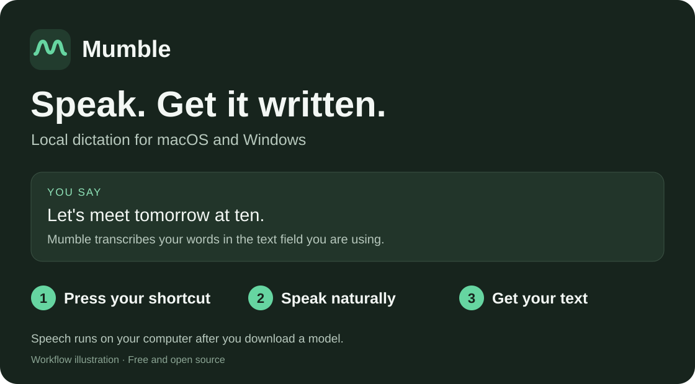
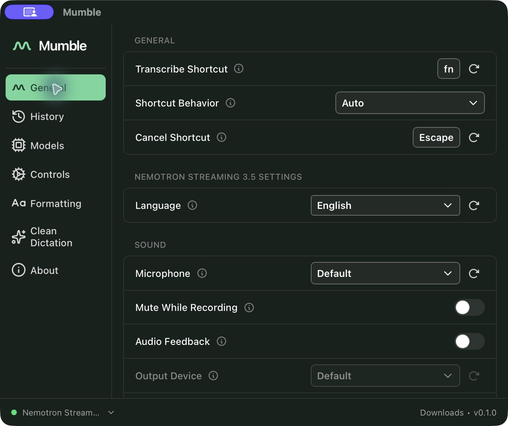
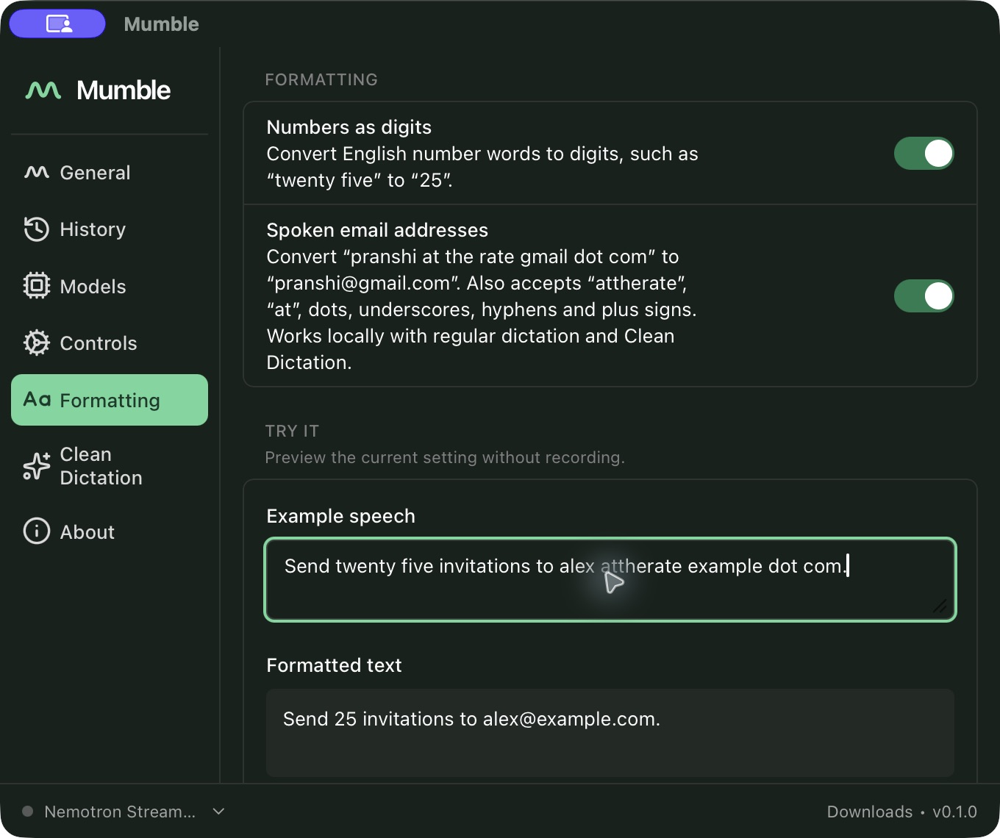
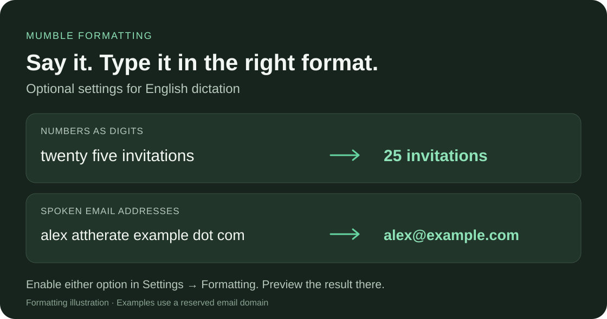

<p align="center">
  <picture>
    <source media="(max-width: 600px)" srcset="docs/images/mumble-overview-compact.svg" />
    
  </picture>
</p>

Mumble is a free, open-source dictation app. Put your cursor in a text field, press your shortcut, and speak. Mumble transcribes on your computer and puts the text into the app you are using.

Use it for messages, emails, notes and drafts. Download a speech model once, then use local dictation offline. Optional English formatting turns spoken numbers into digits and spoken email addresses into complete addresses.

[Download the preview](https://github.com/OsirisMedici/Mumble/releases/tag/v0.1.0-preview.2) · [Install with your agent](#install-with-your-agent) · [Report a problem](https://github.com/OsirisMedici/Mumble/issues)

## Download

| Your computer                                 | Download                                                                                                                                                                                                                                                            | Requirement       |
| --------------------------------------------- | ------------------------------------------------------------------------------------------------------------------------------------------------------------------------------------------------------------------------------------------------------------------- | ----------------- |
| Mac with Apple Silicon, M1 or newer           | [Mac DMG](https://github.com/OsirisMedici/Mumble/releases/download/v0.1.0-preview.2/Mumble_0.1.0_aarch64-apple-darwin.dmg) · [App ZIP](https://github.com/OsirisMedici/Mumble/releases/download/v0.1.0-preview.2/Mumble_0.1.0_aarch64-apple-darwin.app.zip)         | macOS 13+         |
| Mac with an Intel processor                   | [Mac DMG](https://github.com/OsirisMedici/Mumble/releases/download/v0.1.0-preview.2/Mumble_0.1.0_x86_64-apple-darwin.dmg) · [App ZIP](https://github.com/OsirisMedici/Mumble/releases/download/v0.1.0-preview.2/Mumble_0.1.0_x86_64-apple-darwin.app.zip)           | macOS 13+         |
| Windows PC with an Intel or AMD x64 processor | [Windows installer](https://github.com/OsirisMedici/Mumble/releases/download/v0.1.0-preview.2/Mumble_0.1.0_windows_x64-setup.exe) · [Portable ZIP](https://github.com/OsirisMedici/Mumble/releases/download/v0.1.0-preview.2/Mumble_0.1.0_windows_x64_portable.zip) | Windows 10/11 x64 |

These are early preview builds. Mac apps are ad-hoc signed and not Apple notarized. Windows builds are unsigned. Your operating system may ask you to approve the first launch. Windows ARM64 and Linux installers are not included. [Setup, checksums and first-launch help](docs/INSTALL.md).

## Install with your agent

Copy this into your coding agent on the computer where you want Mumble installed:

```text
Install Mumble from https://github.com/OsirisMedici/Mumble.
Read docs/INSTALL.md in that repository first. Detect my OS and CPU,
use the matching official v0.1.0-preview.2 download, and verify its
SHA-256 checksum. Use the repository's install script for my platform.
Preserve existing settings and models. Do not disable OS security or
change system execution policy. Tell me which first-launch permissions
and model download I need to complete myself. Then help me test one
sentence in a normal text field.
```

Or run the matching command yourself. These download the readable install script before running it. No developer tools, Rust build or GitHub login is required.

**macOS, Terminal**

```sh
curl -fsSL https://raw.githubusercontent.com/OsirisMedici/Mumble/main/scripts/install/macos.sh -o /tmp/mumble-install.sh && bash /tmp/mumble-install.sh
```

**Windows, PowerShell**

```powershell
Invoke-WebRequest https://raw.githubusercontent.com/OsirisMedici/Mumble/main/scripts/install/windows.ps1 -OutFile "$env:TEMP\mumble-install.ps1"
& "$env:TEMP\mumble-install.ps1"
```

Quit Mumble before updating. If PowerShell policy prevents running the script, use the Windows installer link above. The scripts do not change that policy. Installation does not grant microphone access or download a speech model automatically.

## Set up and try it

1. Open Mumble. On Mac, grant Microphone and Accessibility access. On Windows, allow desktop microphone access if it is disabled.
2. Download a speech model in **Models**. Parakeet V3 is one option. Model size and speed vary by model and computer.
3. Choose a shortcut in **General**. Quit other dictation apps that use the same shortcut.
4. Put your cursor in a normal text field, use your shortcut, say "This is my first Mumble test", and stop recording. Check that the text appears.
5. To format English numbers and emails, enable the two options in **Formatting**. Try "Send twenty five invitations to alex attherate example dot com". The expected formatted result is `Send 25 invitations to alex@example.com.` Punctuation can vary with the speech model.

## The real app

Actual screenshots from the running macOS app. The Windows build shares these settings, but these images are not Windows screenshots.

### Choose your shortcut and microphone



### Format numbers and spoken email addresses



The screenshot's **Try it** field uses the native formatter. It demonstrates formatting, separately from microphone recognition.

<picture>
  <source media="(max-width: 600px)" srcset="docs/images/mumble-formatting-compact.svg" />
  
</picture>

Both formatting settings start off until you enable them. Spoken email formatting recognizes `attherate`, "at the rate", "at sign", "at" and `@`, along with spoken dots and common separators. Say the full domain, such as "company dot co dot uk". Mumble does not guess a missing `.com`.

## What Mumble does

- Local speech recognition with downloadable Whisper and ONNX speech models.
- Configurable shortcuts, hold-to-talk and toggle recording.
- Microphone selection, transcript history and a recording overlay.
- Optional English number and email formatting, with a local preview.
- Optional Clean Dictation with a provider you configure. Apple Intelligence requires a supported Mac.

Mumble currently transcribes speech. Voice commands that execute tasks and assistant chat are not included.

## Privacy and updates

Local dictation processes audio on your computer. Model downloads need an internet connection. Optional Clean Dictation can send transcribed text to the provider you configure. It is off by default. Local history can contain sensitive text and audio; manage it in Settings.

Preview updates are manual through this repository. The app retains its original `com.osirismedici.karenvoice` identity so existing Karen Voice settings, recordings and downloaded models remain accessible. The visible name is Mumble.

## What has been tested

Release checks cover native builds and startup, packaged dependencies, Windows normal and portable installation, and real speech recognition using generated audio. Formatting tests run on Mac and Windows. Downloads include SHA-256 manifests and machine-readable verification reports.

Those checks do not replace live microphone, global-shortcut and paste testing on each person's desktop. Use the short test above after installation. [Windows acceptance checklist](docs/WINDOWS.md).

## Troubleshooting and contributing

If a shortcut or typing stops working, check permissions and shortcut conflicts, then try a normal text field. macOS Secure Input can block keyboard listeners. After replacing an ad-hoc signed Mac preview, a stale Accessibility entry may need to be removed and the exact installed Mumble app added again. [Installation help](docs/INSTALL.md).

For source builds and contributions, see [BUILD.md](BUILD.md) and [CONTRIBUTING.md](CONTRIBUTING.md). Local dictation is derived from Handy; source provenance and dependency notices are preserved in [THIRD_PARTY_NOTICES.md](THIRD_PARTY_NOTICES.md). Product references include [Superwhisper](https://superwhisper.com/docs/modes/modes), [Wispr Flow](https://wisprflow.ai/) and [VoiceInk](https://github.com/beingpax/VoiceInk).

## License

[MIT](LICENSE). Original copyright and permission notices remain included in the source, apps and downloads.
